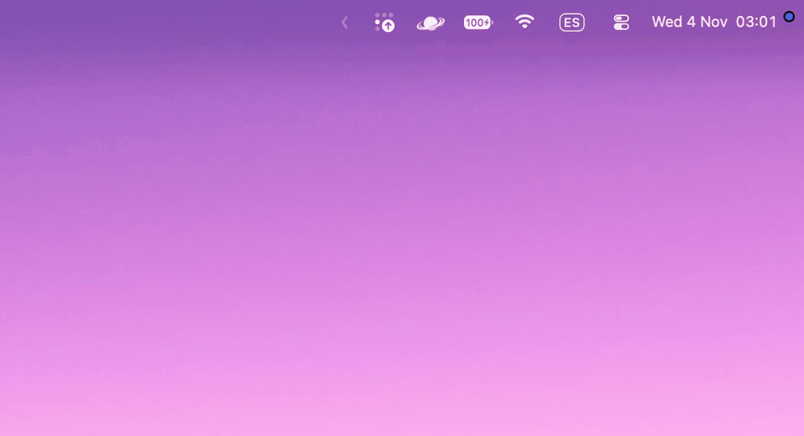

<div align="center">


# Tuckaway

**A quieter menu bar, on your terms.**

Hide the icons you don’t need, without quitting the apps behind them.

<a href="https://github.com/Bruno-Alumn/Tuckaway/releases/latest"></a>

<a href="https://github.com/Bruno-Alumn/Tuckaway/releases/latest"></a>

<a href="LICENSE"></a>

[Features](#features) · [Install](#install) · [Usage](#using-tuckaway) · [Privacy](#privacy) · [Contribute](#contribute)

</div>

---

Tuckaway adds a small arrow to your menu bar. Icons to its left tuck out of sight;
one click brings them back. An independent fork of
[Hidden Bar](https://github.com/dwarvesf/hidden), rebuilt for macOS 27’s new menu
bar and still supporting macOS 13 through 26.

<div align="center">
  
</div>

## Features

| Feature | What it does |
|:--|:--|
| **Auto-collapse** | Hides icons again after a delay, when you switch apps, or when the Mac locks. |
| **Quick reveal** | Hover, click empty menu bar space, or press a global shortcut. |
| **Always-hidden section** | A second section for icons you almost never need. |
| **Notch-aware** | Finds icons stuck behind the camera notch, or shows them in a floating bar. |
| **New-app check** | Asks before hiding a newly installed app’s icon, with an undo. <sub>macOS 27</sub> |
| **Profiles** | Saved layouts that switch by display, time of day, or open app. <sub>macOS 27</sub> |
| **Presentation Mode** | Hides every app’s icon for screen sharing. <sub>macOS 27</sub> |
| **Find Hidden Icon** | Type an app’s name to reach its hidden icon. <sub>macOS 27</sub> |
| **Smart reveals** | Briefly shows an icon that changes or updates, or the one for the app in front. <sub>macOS 27</sub> |
| **Spacers and spacing** | Group icons with blank spacers, or tighten spacing to fit more. |
| **Check Your Setup** | Explains why nothing is hiding, and fixes what it can. |
| **Portable settings** | Export to a file and import on another Mac. |

## Install

Download **Tuckaway.dmg** from the
[latest release](https://github.com/Bruno-Alumn/Tuckaway/releases/latest), drag it
into **Applications**, and grant the [permissions](#privacy) it asks for. Or use
Homebrew:

```sh
brew install --cask bruno-alumn/tuckaway/tuckaway
```

Runs on Apple Silicon and Intel with macOS 13 or later, and checks for updates daily.

> [!NOTE]
> Releases aren’t notarized yet, so macOS may warn on first launch. Choose
> **Open Anyway** in System Settings › Privacy & Security. Coming from Hidden
> Bar? Quit it first; Tuckaway imports its settings (the App Store version’s may
> not carry over).

## Using Tuckaway

Hold <kbd>⌘</kbd> and drag icons to the left of the arrow to hide them, or move
them in **Settings › Menu Bar Items**. Then click the arrow to collapse or expand.

| Action | Result |
|:--|:--|
| Click the arrow | Hide or show icons |
| <kbd>⌥</kbd>-click the arrow | Hide or show the always-hidden section |
| <kbd>Control</kbd>-click the arrow | Open the menu |
| <kbd>⌘</kbd><kbd>,</kbd> | Open Settings |

<div align="center">
  
</div>

## Privacy

No accounts, analytics, or ads. Tuckaway only contacts GitHub to check for and
download updates. See the [Privacy Policy](PRIVACY_POLICY.md).

| Permission | Used for |
|:--|:--|
| **Accessibility** <sub>(Device Control and Data Access on macOS 27)</sub> | Finding, hiding, and clicking menu bar icons |
| **Screen Recording** | Drawing hidden icons in the floating bar, on your Mac only |

## Contribute

Fixes and ideas are welcome, no need to ask first.
[Open an issue](https://github.com/Bruno-Alumn/Tuckaway/issues/new) or send a pull
request against `main`; the [contributing guide](CONTRIBUTING.md) has the details.
AI-assisted work is welcome too: just say what you tested.

<details>
<summary><strong>Build from source</strong></summary>
<br>

You need a current Xcode.

```sh
git clone https://github.com/Bruno-Alumn/Tuckaway.git
cd Tuckaway
xcodebuild -project Tuckaway.xcodeproj -scheme Tuckaway \
  -configuration Debug-Direct CODE_SIGNING_ALLOWED=NO build
```

Run the tests:

```sh
xcodebuild -project Tuckaway.xcodeproj -scheme Tuckaway \
  -configuration Debug-Direct CODE_SIGNING_ALLOWED=NO test
```

Use the **-Direct** configurations. Plain `Debug` and `Release` build the
sandboxed App Store variant, which can’t hide icons on macOS 27.

</details>

<details>
<summary><strong>Project documentation</strong></summary>
<br>

| Document | What’s inside |
|:--|:--|
| [Manual](docs/MANUAL.md) | Settings, shortcuts, permissions, and troubleshooting |
| [Architecture](docs/ARCHITECTURE.md) | Both build lanes and hiding engines, the updater, and known limits |
| [Runbook](docs/RUNBOOK.md) | Verification and release process |
| [Upstream issues](docs/UPSTREAM_ISSUES.md) | Hidden Bar issues addressed by Tuckaway |
| [Backlog](docs/BACKLOG.md) | Planned work and open design questions |
| [Changelog](CHANGELOG.md) | What changed in each release |

</details>

---

Tuckaway is based on [Hidden Bar](https://github.com/dwarvesf/hidden) by
[Dwarves Foundation](https://github.com/dwarvesf) and its contributors, and is
not affiliated with them.

**MIT License:** original work © 2019 Dwarves Foundation; Tuckaway changes ©
2026 Bruno-Alumn. See [LICENSE](LICENSE).

<sub>More Mac apps by Bruno-Alumn: [SolStream](https://github.com/Bruno-Alumn/SolStream) · [ThockBox](https://github.com/Bruno-Alumn/ThockBox)</sub>
