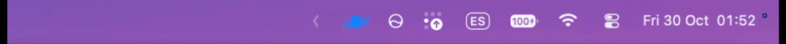
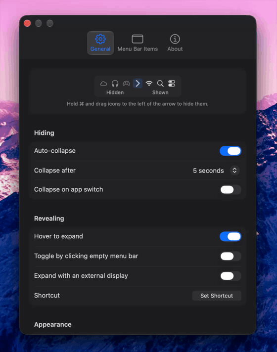

<div align="center">


# Tuckaway

Hide the menu-bar icons you don't need, without quitting the apps behind them.

<a href="https://github.com/Bruno-Alumn/Tuckaway/releases/latest"></a>

<a href="https://github.com/Bruno-Alumn/Tuckaway/releases/latest"></a>

<a href="LICENSE"></a>



</div>

Tuckaway puts an arrow in your menu bar. Icons to the left of the arrow can be
hidden; icons to the right always stay visible. Click the arrow to hide or show
them.

It's a fork of [Hidden Bar](https://github.com/dwarvesf/hidden), which stopped
being able to hide icons on macOS 27. Tuckaway uses macOS 27's own menu-bar
hiding instead, and still works on macOS 13 through 26.

## Install

1. Download `Tuckaway.dmg` from the [latest release](https://github.com/Bruno-Alumn/Tuckaway/releases/latest).
2. Open it and drag Tuckaway into Applications.
3. Launch it and grant the [permissions](#privacy) it asks for.

Releases aren't notarized yet, so macOS may refuse to open the app the first
time. If it does, go to System Settings › Privacy & Security and click
**Open Anyway**.

Tuckaway needs macOS 13 or later, on Apple Silicon or Intel. It checks GitHub
for a new version once a day and can install it for you.

If you're switching from Hidden Bar, quit Hidden Bar first so the two apps don't
fight over the menu bar. Tuckaway copies your Hidden Bar settings the first time
it runs.

## Using it

Hold <kbd>⌘</kbd> and drag icons to the left of the arrow to hide them, or move
them between the Hidden and Visible lists in Settings › Menu Bar Items. After
that:

| Action | Result |
|:--|:--|
| Click or right-click the arrow | Hide or show your icons |
| <kbd>⌘</kbd>-drag an icon | Move it to the hidden or visible side |
| <kbd>⌥</kbd>-click the arrow | Hide or show the always-hidden section |
| <kbd>Control</kbd>-click the arrow | Open the menu (Settings, updates, Quit) |
| Your global shortcut | Hide or show from anywhere |

Settings (<kbd>⌘</kbd><kbd>,</kbd> from the arrow's menu) has three tabs:
General, Menu Bar Items and About.

<p align="center">
  
</p>

## Features

- Hide icons again automatically after 5 seconds to a minute, or as soon as you
  switch apps.
- Show hidden icons by hovering over the menu bar, clicking an empty part of
  it, or pressing a global shortcut.
- Keep rarely used icons in a second, always-hidden section.
- On Macs with a notch, list the icons the notch covers.
- Show hidden icons in a separate floating bar instead of the menu bar (macOS 13–26).
- Expand automatically when an external display is connected.
- Pick a standard arrow, a transparent one, or an ellipsis.

## Privacy

Tuckaway has no accounts, analytics or ads. Its only network request is the
daily update check to GitHub, which you can turn off in Settings. The
[privacy policy](PRIVACY_POLICY.md) has the details.

| Permission | What it's for |
|:--|:--|
| Accessibility (Device Control and Data Access on macOS 27) | Finding where menu-bar icons are, detecting clicks on empty menu-bar space, and passing clicks to hidden icons |
| Screen Recording | Only the separate bar (macOS 13–26), which shows pictures of hidden icons. They stay on your Mac. |

Releases are signed with the same certificate every time, so macOS keeps these
permissions when Tuckaway updates. The one exception is updating from 1.1.0 or
earlier, which asks once more.

## Built with AI

Much of Tuckaway, including the Settings window and the updater, was written
with AI coding agents, then built, tested and tried on a real menu bar before
merging.

## Contributing

Anyone can contribute, and you can use AI however you like to do it.

- Found a bug or have an idea? [Open an issue](https://github.com/Bruno-Alumn/Tuckaway/issues/new). Rough notes and screenshots are fine.
- Want to fix something? Fork the repo and open a pull request against `main`. Small fixes don't need an issue first.
- Looking for somewhere to start? [ARCHITECTURE.md](docs/ARCHITECTURE.md) explains how hiding works.

Before you open a pull request, make sure it builds, the tests pass, you've
tried it on a real menu bar, and the description says what you checked. The
[contributing guide](CONTRIBUTING.md) has the commands.

<details>
<summary><b>Build from source</b></summary>
<br>

You need a current Xcode.

```sh
git clone https://github.com/Bruno-Alumn/Tuckaway.git
cd Tuckaway
xcodebuild -project Tuckaway.xcodeproj -scheme Tuckaway \
  -configuration Debug-Direct CODE_SIGNING_ALLOWED=NO build
```

Run the tests:

```sh
xcodebuild -project Tuckaway.xcodeproj -scheme Tuckaway \
  -configuration Debug-Direct CODE_SIGNING_ALLOWED=NO test
```

Use the `-Direct` configurations. Plain `Debug` and `Release` build the
sandboxed App Store version, which can't hide icons on macOS 27.

</details>

<details>
<summary><b>Documentation</b></summary>
<br>

| | |
|:--|:--|
| [Manual](docs/MANUAL.md) | Every setting, shortcut and troubleshooting step |
| [Architecture](docs/ARCHITECTURE.md) | The two builds, both hiding methods, the updater, known limits |
| [Runbook](docs/RUNBOOK.md) | Testing and releasing |
| [Upstream issues](docs/UPSTREAM_ISSUES.md) | Which Hidden Bar issues are fixed here |
| [Backlog](docs/BACKLOG.md) | What's next |
| [Changelog](CHANGELOG.md) | Changes by release |

</details>

---

Tuckaway is based on [Hidden Bar](https://github.com/dwarvesf/hidden) by
[Dwarves Foundation](https://github.com/dwarvesf) and its contributors, and isn't
affiliated with them. MIT License: original work © 2019 Dwarves Foundation,
Tuckaway changes © 2026 Bruno-Alumn.
