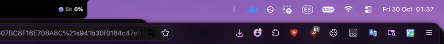
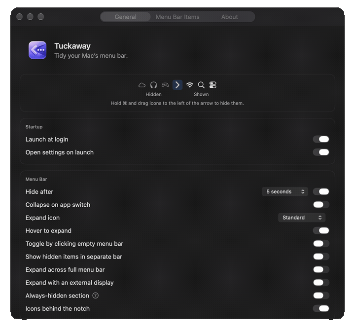

<p align="center">
  
</p>

<h1 align="center">Tuckaway</h1>

<p align="center">
  <strong>Tidy your Mac’s menu bar.</strong><br>
  Choose what stays visible. Tuck away everything else.
</p>

<p align="center">
  <a href="https://github.com/Bruno-Alumn/Tuckaway/releases/tag/v1.0.0"></a>
  
  
  <a href="LICENSE"></a>
</p>

<p align="center">
  <a href="#install">Install</a> ·
  <a href="#features">Features</a> ·
  <a href="#permissions">Permissions</a> ·
  <a href="#build-from-source">Build</a> ·
  <a href="#license">License</a>
</p>

---

<p align="center">
  
</p>

Tuckaway is a fast, native macOS utility for decluttering the menu bar without
quitting the apps behind it. Arrange your icons once, then collapse and reveal
them with a click, keyboard shortcut, hover, or empty-menu-bar click.

Tuckaway is an **independent, MIT-licensed fork of
[Hidden Bar](https://github.com/dwarvesf/hidden)**, maintained by
[Bruno-Alumn](https://github.com/Bruno-Alumn). It is not affiliated with or
endorsed by the original maintainers.

## Features

| | |
|---|---|
| **One-click cleanup** | Collapse and expand selected menu-bar icons instantly. |
| **Automatic tidying** | Auto-collapse after a delay or when another app becomes active. |
| **Flexible reveal** | Click, right-click, hover, use a global shortcut, or click empty menu-bar space. |
| **Always-hidden section** | Keep rarely used icons out of sight until you explicitly reveal them. |
| **Notch overflow** | Reach icons concealed behind the camera notch. |
| **Separate hidden-items bar** | Display and interact with hidden icons in a floating row. |
| **Display-aware behavior** | Optionally expand when an external display is connected. |
| **Your preferred appearance** | Choose standard, transparent, or ellipsis expand icons. |
| **Background startup** | Launch at login with or without opening Preferences. |
| **Built-in updates** | Check GitHub releases daily or on demand, then install and relaunch in one click. |

## Install

1. Download **Tuckaway.zip** from the
   [v1.0.0 release](https://github.com/Bruno-Alumn/Tuckaway/releases/tag/v1.0.0).
2. Unzip it and move **Tuckaway.app** to **Applications**.
3. Launch Tuckaway and grant the permissions below.

Tuckaway supports **macOS 13 Ventura or later** on Intel and Apple Silicon.
Current release builds are ad-hoc signed; if macOS warns you, review the app in
Finder and choose **Open** only if you trust this release. Apple notarization is
planned for a future release.

### Upgrading from Hidden Bar

Tuckaway migrates your existing preferences once, including your auto-collapse
delay. It never overwrites preferences you later change in Tuckaway. Quit Hidden
Bar before using Tuckaway so the two apps do not compete for the menu bar.

## Quick start

1. Hold **⌘** and drag icons relative to Tuckaway’s arrow. Icons on the hidden
   side collapse; icons on the visible side remain.
2. Click the arrow to collapse or expand. Right-click also toggles;
   **Control-right-click** opens the menu.
3. Open **Preferences** to configure automatic collapse, startup, appearance,
   hover, separate-bar display, and external-display behavior.
4. Option-click the arrow, or choose **Hide/Show Separators**, to change the
   always-hidden presentation.

<p align="center">
  
</p>

## Permissions

| Permission | Why Tuckaway uses it |
|---|---|
| **Accessibility / Device Control and Data Access** | Reads icon positions, identifies empty menu-bar space, and forwards clicks to hidden items. On macOS 27, this appears as **Device Control and Data Access** in System Settings. |
| **Screen Recording** | Captures hidden icons only when separate-bar or related capture features are enabled. Captures remain on your Mac. |

Tuckaway has **no accounts, analytics, advertising, tracking, or data upload**.
See the [Privacy Policy](PRIVACY_POLICY.md).

## Build from source

Install current Xcode, then run:

```sh
git clone https://github.com/Bruno-Alumn/Tuckaway.git
cd Tuckaway
xcodebuild -project "Tuckaway.xcodeproj" -scheme "Tuckaway" \
  -configuration Debug-Direct CODE_SIGNING_ALLOWED=NO build
```

Run the complete test suite:

```sh
xcodebuild -project "Tuckaway.xcodeproj" -scheme "Tuckaway" \
  -configuration Debug-Direct CODE_SIGNING_ALLOWED=NO test
```

Local unsigned or ad-hoc-signed builds can require a fresh permission grant
when their signature changes.

## Documentation

- [Manual](docs/MANUAL.md) — every setting, permission, and troubleshooting step
- [Architecture](docs/ARCHITECTURE.md) — hiding engines, topology, and known limits
- [Maintainer runbook](docs/RUNBOOK.md) — verification and release process
- [Upstream issue status](docs/UPSTREAM_ISSUES.md) — integrated fixes and external blockers
- [Contributing](CONTRIBUTING.md) — contribution process and code of conduct

## Acknowledgments

Tuckaway builds on Hidden Bar and contributions from its community. The original
copyright and MIT notices are preserved. See
[upstream issue integration status](docs/UPSTREAM_ISSUES.md) for incorporated
fixes and current platform limitations.

## License

**MIT License**

- Original work: **Copyright © 2019 Dwarves Foundation**
- Tuckaway modifications: **Copyright © 2026 Bruno-Alumn**

You may use, copy, modify, merge, publish, distribute, sublicense, and sell the
software under the terms of the [MIT License](LICENSE). The software is provided
**“as is,” without warranty of any kind**.
