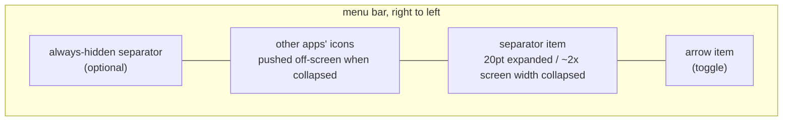
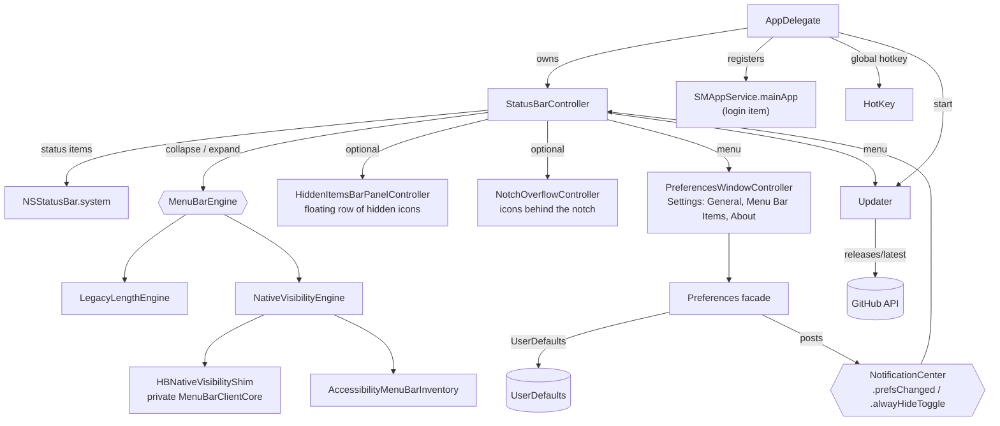

# Architecture

Tuckaway is a single-process AppKit menu-bar utility: about 5.7k lines of Swift
plus a small Objective-C shim, with one dependency,
[HotKey](https://github.com/soffes/HotKey). There is no helper app or daemon.
Its only network use is the direct build's update check. The UI is the arrow
and separator status items, their menu, and one Settings window.

## Two builds

The same target builds two ways, chosen by configuration:

| | Direct download (`Debug-Direct`, `Release-Direct`) | App Store (`Debug`, `Release`) |
|---|---|---|
| Sandbox | No (`Hidden-Direct.entitlements` is empty) | Yes (`Hidden.entitlements`) |
| Compile flag | `HIDDENBAR_NATIVE_VISIBILITY` | none |
| Hiding on macOS 27 | `NativeVisibilityEngine` | none; shows a one-time notice |
| Hiding on macOS 13–26 | `LegacyLengthEngine` | `LegacyLengthEngine` |
| Menu Bar Items manager, macOS 27 sections | Yes (Accessibility works outside the sandbox) | No |
| Updater | Yes | Hidden |

The **Tuckaway** scheme runs and archives the direct configurations; the
**Tuckaway App Store** scheme uses the sandboxed ones. Releases on GitHub must
come from `Release-Direct` (see the [runbook](RUNBOOK.md#release)).

## Hiding engines

`StatusBarController` decides *what* the user wants (collapsed or expanded,
which sections exist). A `MenuBarEngine` decides *how* the menu bar is made to
do it. The controller calls `collapse` / `expand` / `updateAlwaysHiddenSection`
/ `invalidateLayout` and never writes a status-item length itself.
`MenuBarEngineFactory` is the one place that picks an engine:

```swift
usesNativeVisibility  // HIDDENBAR_NATIVE_VISIBILITY && macOS >= 27
    ? NativeVisibilityEngine(items:)
    : LegacyLengthEngine(items:)
```

### LegacyLengthEngine (macOS 13–26)

macOS offers no API to hide other apps' icons before macOS 27, so this engine
fakes it with geometry. The separator status item's **length is inflated to
roughly the width of the widest attached screen**, pushing every icon to its
left off-screen. Collapsing and expanding flips that length between about 20pt
and the inflated value.



- The menu bar repeats on every display, so the collapse length comes from the
  **widest** screen (`NSScreen.screens`), never `NSScreen.main`. It is
  re-applied on `didChangeScreenParametersNotification` (display hot-plug).
- The length is bounded: `max(500, min(widestFrameWidth * 2, 10_000))`. macOS
  enforces a hard 10,000pt maximum on `NSStatusItem.length`.
- `isCollapsed` is derived state (`separator.length > 20`), not an equality
  check, so it survives the length being recomputed while collapsed.
- macOS inserts new status items on the far left, which is inside the hidden
  zone; that is inherent to the trick.
- On macOS 27 the system ejects an over-wide separator from the layout (#360).
  The engine detects that, expands, and posts `legacyHideUnavailable`. The
  App Store build then shows its one-time notice pointing at the direct
  download.

### NativeVisibilityEngine (macOS 27, direct build)

macOS 27 has a menu-bar visibility restriction behind its assessment (exam)
mode. This engine reads which apps the user ⌘-dragged into each section and asks
macOS to keep only the visible ones. macOS hides the rest and reflows the bar
itself, so the result doesn't depend on display width, the notch, or the
frontmost app's menus.

- **The arrow is the boundary.** Apps left of it (LTR) are hidden; the regular
  separator is taken out of the bar. The always-hidden separator, when enabled,
  marks a third section and is shown only while that section is visible so it
  can be ⌘-dragged.
- **`HBNativeVisibilityShim` (Objective-C)** is the only code that touches the
  private `MenuBarClientCore` framework. It is Objective-C so exceptions from a
  changed private API can be caught instead of crashing. Without the compile
  flag it reports the API as unavailable. `NativeVisibilityBridge` wraps the
  held restriction: hiding lasts until it is invalidated or the process exits,
  when macOS restores the bar by itself.
- **`AccessibilityMenuBarInventory`** lists other apps' status items through
  public Accessibility API (each app's `AXExtrasMenuBar`). It needs the
  Accessibility permission (shown as Device Control and Data Access on 27) and
  cannot work in the sandbox. **`MenuBarLayout`** resolves each item's section
  from its frame relative to the separators, per display.
- **Granularity is per app.** The restriction takes bundle identifiers, so an
  app's icons hide or show together (#427).
- **Assessment-mode side effects (#437).** While collapsed, macOS also hides
  Now Playing, Live Activities and the recording-indicator capsule, and ignores
  clicks on the clock. Two monitors soften this:
  - **`CaptureActivityMonitor`** watches microphone and camera use through
    public CoreAudio/CoreMediaIO state. While either is active, no restriction
    is held, so the recording capsule stays visible.
  - **`MenuBarClock`** watches for clicks on the clock, briefly lifts the
    restriction and presses the clock through Accessibility, so Notification
    Center still opens.

  Screen recording has no public signal and is not covered.

## Topology



- **`AppDelegate`**: registers default preferences, enforces a single running
  copy, migrates Hidden Bar preferences once, sets up the hotkey and login
  item, and starts the updater.
- **`StatusBarController`** (`Features/StatusBar`, the core of the product):
  - owns the status items and builds a fresh menu on every Control-click;
  - decides when to collapse and expand: auto-collapse timer, collapse on app
    switch, hover to expand, empty-menu-bar clicks, external-display expansion;
  - restores the status items if they were ⌘-dragged off the bar.
- **`Preferences`** (`Common/Preferences.swift`): typed accessors over
  `UserDefaults`. Setters post `NotificationCenter` notifications that the
  controller and the Settings window observe; there is no other state store.
- **Settings window** (`Features/Preferences`, `Features/About`):
  - `PreferencesWindowController` is an `NSTabViewController` with native
    toolbar tabs.
  - **General** is a SwiftUI grouped `Form` (`GeneralSettingsView`) bound
    straight to `Preferences`.
  - **Menu Bar Items** (`MenuBarItemManagerViewController`) lists items through
    Accessibility. It moves them by posting a synthetic ⌘-drag in the real menu
    bar.
  - **About** is SwiftUI.
  - Global-shortcut recording goes through a local event monitor while the
    General tab is listening.
- **`HiddenItemsBarPanelController`**: the optional separate bar. It captures
  hidden icons (Screen Recording) into a floating panel and forwards clicks
  (Accessibility).
- **`NotchOverflowController`**: on notched Macs, lists icons the notch covers
  in a menu (**Show Notch Items**). Its geometry is pure and unit-tested.
- **`Updater`** (`Features/Update`): see [Updates](#updates).

## Behavior layers

| Layer | Mechanism | Cost when unused |
|---|---|---|
| Auto-collapse | One-shot `Timer` after expanding. When it fires with the pointer in any screen's menu-bar band, it re-arms instead of collapsing. | None |
| Collapse on app switch | `NSWorkspace.didActivateApplicationNotification` | None |
| Hover to expand | Global `.mouseMoved` monitor plus a 0.5s dwell timer, installed only while the preference is on | Monitor not installed |
| Empty-menu-bar click | Global click monitor; an Accessibility hit test confirms the click hit the bare `AXMenuBar` | Monitor not installed |
| Self-restore | `isVisible = true` forced on Tuckaway's items at launch; ⌘-dragging them off would otherwise leave no UI | None |
| Always-hidden section | A second separator item, gated by `alwaysHiddenSectionEnabled` | Item not created |

## Updates

`Updater` runs only when the app isn't sandboxed (the direct build).

1. **Check:** a `GET` to
   `api.github.com/repos/Bruno-Alumn/Tuckaway/releases/latest`. It runs about
   10 seconds after launch and on a 6-hour timer, but only once a day has
   passed (`lastUpdateCheck`), and only when `automaticallyChecksForUpdates` is
   on. Manual checks ignore both conditions.
2. **Compare:** `ReleaseVersion` compares dotted numbers (`1.10 > 1.9`,
   `1.2 == 1.2.0`). Drafts and prereleases are ignored, and
   `skippedUpdateVersion` suppresses automatic prompts only.
3. **Download:** `GitHubRelease.appPackage` picks `Tuckaway.dmg`, falling back
   to a zip for releases made before the DMG switch.
4. **Unpack:** a DMG is mounted read-only with `diskutil image` on macOS 27
   (`hdiutil` on older systems) and the app copied out with `ditto`; a zip is
   extracted with `ditto`.
5. **Verify:** the app must have the same bundle ID, a version equal to the tag,
   pass `codesign --verify --deep --strict`, and satisfy the running app's
   designated requirement (same bundle ID and signing certificate; checked
   with `SecStaticCodeCheckValidity`). A running app that is itself ad-hoc
   signed (1.1.0 and earlier) has no certificate to match and skips that last
   check. If anything fails, nothing on disk changes.
6. **Swap:** the running bundle is moved aside and the new one moved in, rolling
   back if the second move fails. A detached `/bin/sh` waits for the old process
   to exit, opens the new app, and deletes the backup.

Translocated or read-only copies get a **Download** button that opens the
release page instead.

## Autostart

macOS 13+ `SMAppService.mainApp`: the app registers itself, and the login item
is visible and revocable in System Settings › General › Login Items. If
registration fails, the preference reverts and an alert explains where to fix
it. On first launch after upgrading, a one-time migration deauthorizes the
legacy `com.dwarvesv.LauncherApplication` helper registration (the BTM database
never garbage-collects those; see Apple TN3111). The helper app itself is gone.

## Security posture

- **App Store build:** sandboxed, hardened runtime, no network entitlement, no
  file I/O, no IPC surface, no shell or subprocess use.
- **Direct build:** unsandboxed, because native hiding and the Accessibility
  inventory don't work in the sandbox.
  - It loads one private framework, `MenuBarClientCore`, only through the
    exception-catching shim.
  - Its only network request is the update check. The updater is also the only
    code that runs subprocesses (`diskutil`/`hdiutil`, `ditto`, `codesign`,
    `xattr`, and the `/bin/sh` relauncher). They get fixed tool paths and pass paths as
    arguments, never interpolated into a shell string.
- **Both builds:**
  - The only dependency, HotKey (a small Carbon `RegisterEventHotKey` wrapper),
    is locked by the committed `Package.resolved`.
  - The hover monitor only reads pointer position.
  - About-window links are hardcoded.
- Releases are signed with a self-signed certificate, the same one every time
  (see the [runbook](RUNBOOK.md#release-signing)). macOS's privacy permissions
  key on that identity, so they survive updates. Gatekeeper still treats the app
  as unidentified until there is a Developer ID.

## Known architectural limits

- **macOS 27 is per app and private.** Native hiding uses a private framework
  and assessment mode. Apps hide as a whole (#427), the side effects in #437
  remain for Now Playing, Live Activities and screen recording, and a future
  macOS could change or remove the API.
- **App Store build on macOS 27** cannot hide: the sandbox denies the
  Accessibility lookups that locate the sections.
- **The notch (legacy engine):** hidden icons can sit under the notch. Notch
  overflow lists them in a menu rather than moving them.
- **Other apps' open menus:** interaction awareness is based on pointer
  position. A pointer deep inside another app's open dropdown is below the
  menu-bar band, so an auto-collapse can still fire there.
- **DMG tooling requires macOS 13–26 fallback.** macOS 27 uses `diskutil
  image`; older systems use the deprecated but still supported `hdiutil`.
